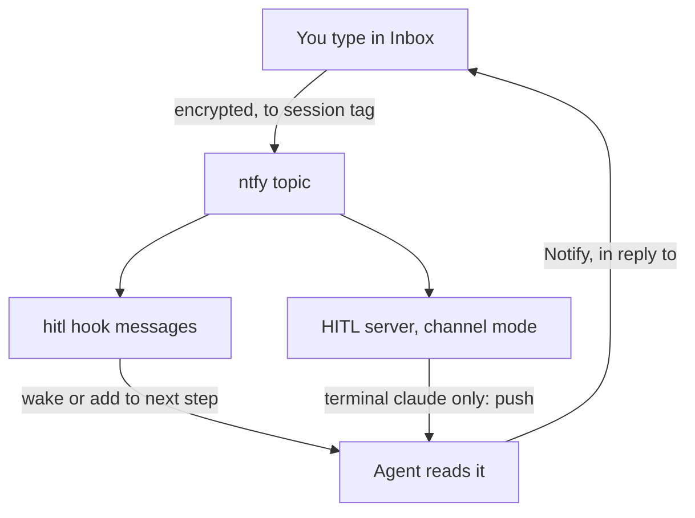

# Plan: Send a message to a running agent from Inbox

**Done when:** you type a message in Inbox next to a session. The agent reads it and replies in Inbox.
- Claude Code (terminal, desktop app, VS Code): it arrives at once, even if the agent is idle.
- Codex and Copilot: it arrives at the agent's next step or when it stops. These hosts cannot be woken.

## Key dots

1. **Spike result.** The MCP channel push works in terminal `claude` only. The desktop app and VS Code drop it. A background Stop hook woke an idle session in both.
2. **Hooks are the backbone.** A new `hitl hook messages` command reads this session's messages from ntfy's 12-hour history. Claude: one background waiter per session wakes the agent. Tool hooks deliver mid-task.
3. **MCP channel, terminal only.** With the channel flag, the HITL server pushes the message itself. Each message is delivered once, by whichever path gets it first.
4. **Codex and Copilot.** Their tool hooks deliver mid-task. Their Stop hook holds the agent if a message waits.
5. **Each session gets an address.** A private tag (a hash of the session id). Inbox sends to it. The raw id never leaves the machine.
6. **Reply by Notify.** Notify gets an "in reply to" link. Inbox marks your message "replied".

## Your decision

**Keep the MCP channel path?** Hooks already cover every Claude app. The channel adds a true push in terminal `claude`, plus a check for the channel flag.
- **Recommendation:** keep it, built after the hooks. It is what you asked for, and it is small.
- **Safe default:** keep it.

## Proof

- Unit tests: address match, other tags ignored, undecryptable messages dropped, delivered once, reply link.
- Manual: `hitl send` and Inbox → idle session in the desktop app, terminal `claude`, Codex and Copilot. Reply shows in Inbox. Screenshots kept.

## Material risks

- **Codex and Copilot cannot be woken.** A message waits until the agent's next step or prompt.
- **A dev flag is needed for the channel.** `claude --dangerously-load-development-channels server:hitl`. Claude asks you to confirm.
- **Codex and Copilot session ids are unchecked.** If their hook ids differ from the server's, nothing matches. Checked before step 6.
- **Your HITL key can steer agents.** Same as HandOff replies today. A message is a request, never approval for risky actions.

**Now / next:** scope is all three hosts, approved to build (10 Oct). No commit or push unless asked. Spike done. Next: steps 2–3.

---

## Reference (optional detail)

**Build order**
1. **Spike. Done.** Channel push works in terminal `claude` only. The rewake Stop hook works in SDK mode (desktop, VS Code). Hook and server share the session id.
2. **Address and sending.** Session tag on outgoing messages; `agent_message` type; `hitl send <tag> "text"`. *Done:* unit test: right tag accepted, other tag ignored.
3. **`hitl hook messages`.** Poll ntfy since a per-session cursor. Claims each message once (a local marker file). Output per host: Claude rewake (exit 2), tool-hook context, Stop block. One waiter per session: a pid file; a new waiter replaces the old; it exits when the session ends. *Done:* `hitl send` wakes an idle desktop Claude session; three stops leave one waiting process.
4. **Notify `inReplyTo` and channel push.** The server pushes in channel mode, using the same claim. *Done:* the reply carries the message id; terminal `claude` gets a push, not a duplicate.
5. **Inbox compose box.** Text box on the session pane, plus "sent / replied". *Done:* manual run on Windows, with a screenshot.
6. **Codex and Copilot hooks.** First check that each host's hook session id gives the same tag as the server (Codex `_meta.threadId`, Copilot `COPILOT_AGENT_SESSION_ID`). Then wire the same command into their hooks via the hitl plugin. *Done:* tags match in both hosts; manual runs in both, plus hook tests.

**Details**
- **Channel contract:** declare `capabilities.experimental['claude/channel']: {}` and `tools: {}`. Emit `notifications/claude/channel` with `{ content, meta: { from, message_id } }`. Source: [channels reference](https://code.claude.com/docs/en/channels-reference). The docs say the dev flag is ignored in `-p` and the Agent SDK; the spike confirmed it.
- **Channel-mode check:** the server reads its parent `claude` command line for the channel flag naming HITL. Without it, the server does not claim messages, so the hook delivers them.
- **Wire message:** `{ type: 'agent_message', id, to: <sessionTag>, text, respondedFrom, timestamp }`, encrypted like every HITL message. Separate topic `<topic>-agents`. Old Inbox and tray apps ignore it.
- **Session tag:** first 12 hex characters of `sha256('hitl-session:' + rawSessionId)`. Hooks compute it from the hook input's `session_id`.
- **Reachability:** a session appears in Inbox after its first HITL message.
- **Why not channels in Codex and Copilot (checked 10 Oct 2026):**
  - Codex: requests to surface MCP notifications are still open: [#17543](https://github.com/openai/codex/issues/17543), [#15299](https://github.com/openai/codex/issues/15299), [#18056](https://github.com/openai/codex/issues/18056). The newest release (0.162.1, 9 Oct) has no such change. Its "message board" push ([openai/codex#49686](https://github.com/openai/codex/pull/49686)) is built in, not MCP, and does not wake idle agents.
  - Copilot CLI: [changelog](https://github.com/github/copilot-cli/blob/main/changelog.md) up to 1.0.95 (9 Oct) and the [command reference](https://docs.github.com/en/copilot/reference/copilot-cli-reference/cli-command-reference) have no channel or push feature.
- **Out of scope:** permission relay, Codex app-server steering.
- **Code touch points:** `identity.ts` (tag), `cli.ts` (`send`, `hook messages`), new `agent-messages.ts`, `mcp-server.ts:112` (capabilities, instructions, Notify `inReplyTo`), Inbox session pane, hitl plugin hooks.
