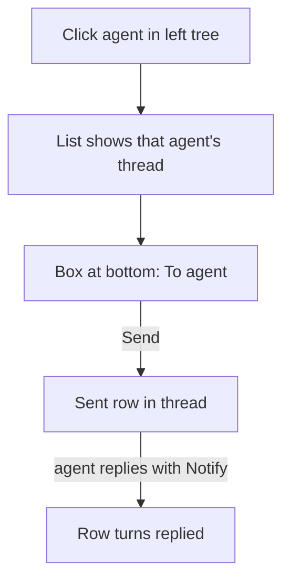

# Plan: Pick an agent in Inbox, then message it

**Done when:** in the running Inbox, you click an agent in the left tree, type in the box under its list, press Send, and the agent replies. This includes an agent that has only sent work updates.

## Key dots

- **Pick, then type.** Selecting an agent (a session row) shows a message box at the bottom of the middle list: "To: <agent>". That list becomes the agent's thread: its messages, what you sent, and its replies.
- **Work updates get an owner.** Today UpdateWork never says which session sent it, so work rows have no agent and no box. The server will attach the sender, as it already does for Notify and questions.
- **No hidden box.** If the selected agent can't take messages yet, the box shows but is disabled, with the reason: "Restart this agent to message it (its HITL is older)." With "All agents" or a project selected, it says: "Pick an agent to message it."
- **Reply in context stays.** The box under an open message stays too. Both send the same way.

## Your decision

Keep the box under an open message as well as the new one under the list?
- **Recommendation: keep both.** Under a message reads as "reply to this". Under the list reads as "message this agent".
- **Safe default:** keep both. Removing one later is a small change.

## Proof

- UI tests: the box appears for a tagged agent, is disabled with a reason for an untagged one, and shows the hint for "All agents" or a project. Send calls `send_agent_message` with the agent's tag.
- Rust test: a work update with a sender lands under its session and carries the tag.
- Server test: UpdateWork publishes the sender identity.
- Live: a screenshot of sending to a selected agent in your Inbox, then its reply.

## Material risks

- An agent's tag is known only after it sends something through the new HITL server. A freshly restarted agent that hasn't spoken yet shows the disabled box.
- A work document shared by several agents is filed under the first agent that identified itself.

**Now / next:** done 2026-10-11. Server 365/365, Inbox Rust 193/193, UI 250/250, live pick-and-send replied. Live check found one more fix: a send from the list box switches the list to All, so the sent row is visible.
