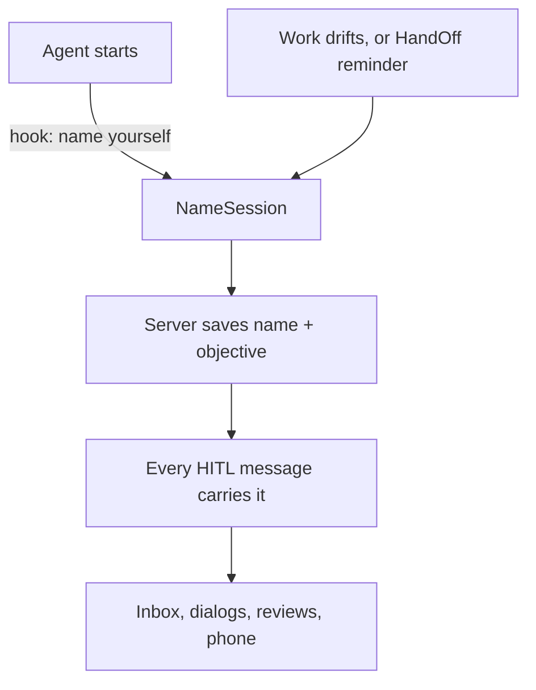

# Plan: Every agent names itself, and you see that name everywhere

**Done when:** a new agent's first HITL message shows its own name and objective wherever you read it: Inbox, browser dialogs, plan reviews and phone notifications. When its work drifts, it renames itself, and Inbox shows "formerly …". Today you see "master · a3f2" instead.

## Key dots

- **New tool `NameSession`.** The agent gives a short name ("Inbox repaint fix") and a one-line objective.
- **Renames when the work drifts.** The session-start text, the every-prompt line and the skill all say: "If your objective changed, call NameSession again." HandOff and resume also remind it: each HandOff result ends with "Still on '<objective>'? If not, call NameSession."
- **You see the chain.** Inbox keeps every name a session had. It shows the newest name, then "formerly Inbox repaint fix, earlier Android build" in the detail and on hover.
- **The name rides on every message.** The server adds the name and objective to the sender it already attaches to questions, notifications, handoffs and work updates.
- **The name survives a restart.** The server saves it per session (`~/.hitl/sessions/<tag>.json`). A resumed session reloads it.
- **You see the name first, everywhere.** Inbox (tree, rows, detail, "To:"), browser dialogs, plan reviews and phone notifications. Branch and id stay as small grey text, so two sessions on one branch still differ.
- **A nudge, not a wall.** Until a session is named, HITL tool results end with "Name this session with NameSession." Questions still go through.

## Your decision

You asked "Can you update the name on the UI side?" Should you be able to rename an agent from Inbox?
- **Recommendation: yes, through the agent.** A "Rename" button on the agent sends it a message: "Rename this session to X." The agent calls NameSession, so the name and the "formerly" chain stay in one place. Works for agents that can take messages today.
- **Alternative: Inbox-only label.** You type a name; only your Inbox shows it. The agent and other devices never see it.
- **Safe default:** no rename button now; agents name themselves.

## Proof

- Server tests: NameSession saves; the next Notify carries it; a restarted server still has it; the nudge shows only while unnamed; HandOff results carry the drift reminder.
- Inbox and client tests: the newest name shows on tree, rows, "To:", dialog and notification; a renamed session shows "formerly …".
- Plugin test: session-start and every-prompt text carry the new wording.
- Live: a fresh agent names itself, then renames; screenshots of Inbox and a browser dialog.

## Material risks

- Agents already running stay unnamed until restarted (their HITL and hooks are older).
- An agent may pick a vague name. The tool asks for "what you are doing, in 2-5 words", and the objective fills the gap.

**Now / next:** done 2026-10-13. Server 372/372, Inbox Rust 201/201, Inbox UI 259/259, tray UI pass, plugin 15/15. Live: a fresh agent named itself unprompted, then renamed twice from Inbox's Rename button. Live check found one more fix: an open message now updates its name in place.
