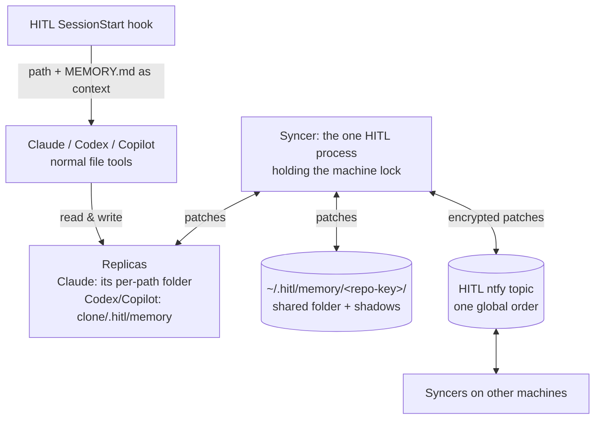
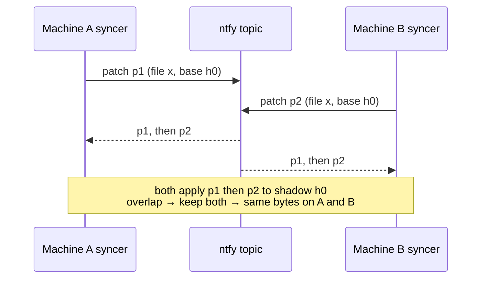

# Plan: every agent on every machine keeps the same memory files for a repo, with no conflicts

**Done when:** two machines (or two clones) edit a repo's memory at the same time, and afterwards both hold byte-identical files with both edits in them. Claude, Codex and Copilot all see those files. No conflict files, no human step.

## Key dots
1. **Same files everywhere.** One folder per repo, `~/.hitl/memory/<repo-key>/`, keyed by git origin. It uses Claude's format: one `.md` per fact plus a `MEMORY.md` index. Agents use their normal file tools. No new memory tools.
2. **Each host works on a local replica; the syncer merges replicas into the shared folder.**
   - **Claude:** keeps its own per-path memory folder.
   - **Codex and Copilot:** use `<clone>/.hitl/memory/`, hidden through `.git/info/exclude`.
   - The HITL SessionStart hook injects the index and the path.
   - Changed after testing; see "Test findings".
3. **Nobody has to say "memory changed", and nobody starts the syncer by hand.** Every host already launches a HITL MCP server per session. Each one tries to take a machine-wide lock at startup. The winner runs the syncer and watches the folder; the rest stay idle. When it exits, the next server takes over.
4. **Conflict-free by construction.** Each change is sent as a patch against the last synced version. ntfy puts all patches in one order. Every machine applies them identically, so every machine ends identical. On a real clash, **both fragments are kept**, side by side, and you get a Notify naming the file.
5. **Only `.md` files sync, and they stay small.** A change of ≤ 2 KB goes inline. Bigger ones use the existing chunking and attachment upload. A file over 256 KB is skipped, and you get a Notify.
6. **Bootstrap:** import the 19 Claude memory folders already here; a new machine asks a live peer for a snapshot; optionally, memories distilled from your Inbox answers, reviewed by you first.

## Proof
A scripted test with two fake machines making clashing edits ends with identical bytes · Codex and Copilot sessions list the memory · two real machines converge · unit tests for repo key, patch merge, lock handover.

## Material risks
- Secrets would sync. Mitigations: end-to-end encryption, plus a secret-pattern guard that skips the file and notifies you.
- "Keep both" can leave duplicate or contradicting lines. They are visible in the file, and Claude's consolidate-memory skill cleans them up.

**Now / next:** your review → slice 1 (shared folder plus hooks, one machine) → slice 2 (sync between machines).

---

## Reference (optional detail)

### Test findings (slice 1 spike, 2026-10-08)

| Tried | Result |
|---|---|
| Junction from Claude's per-path `memory` folder to the shared folder | Reads OK, but **writes blocked**: Claude's safety check calls it a "sensitive file". Allow rules can't override this. |
| `autoMemoryDirectory` pointing at a real shared folder | **Works**: index read, file and index line written. But it can only be set per clone in `.claude/settings.local.json`, which is **committed** in Hitl_MCP. |
| Codex SessionStart hook | Injects context in Claude's format. Needs `additionalContextLimit` raised, and a **one-time trust** in Codex `/hooks`. |
| Copilot CLI sessionStart hook | Injects context only as top-level `{"additionalContext": "…"}`. No trust step. |

**So, replicas:**
- Every place a host keeps memory is a replica of the shared folder.
- The syncer merges each replica with the shared folder using the same patch engine that syncs machines. It's one engine; machines are just remote replicas.
- **Claude:** the replica is its own per-path folder, so the existing `MEMORY.md` loading and write permissions are untouched.
- **Codex and Copilot:** the replica is `<clone>/.hitl/memory/`. It is inside the workspace, so their sandboxes allow writes. It is hidden from git through `.git/info/exclude`, which is local, shared by worktrees, and never committed.
- **Cost:** a change reaches another clone after the syncer's next tick (≤ 10 s), not instantly.

### Who does what

- **Agents** only read and write files in their replica. They never call sync, and they never need to know it exists.
- **The SessionStart hook** gives every host the path and the format rules, and injects `MEMORY.md`. It is one command (`hitl hook session-start`) registered in each host's hook config.
- **The syncer** is the only process that writes changes it didn't make itself: into replicas and the shared folder. It is a role, not a new app: whichever HITL process (MCP server or tray client) holds the lock runs it.
- **The topic** is the sequencer. ntfy gives every message one position in one order, and every machine sees that same order.

### What syncs, and how it fits through ntfy

- **Only `*.md` files** directly in the repo's memory folder. Anything else there is ignored.
- **One message per sync tick, not per keystroke.** The watcher waits 10 s after the last change, then bundles every changed file's patch into one message.
- **Size:**
  - The bundle is gzipped, then encrypted.
  - Up to 2 KB, it goes inline, under ntfy's 4 KB message limit after encryption.
  - Larger bundles use the paths that already exist for plans: chunked messages, or one attachment upload. They are consumed live, so the 3 h attachment expiry does not matter.
- **Caps:**
  - A single file over 256 KB is skipped, and you get a Notify. Claude's own cap is 1 MiB; real memory files here are a few KB.
  - Snapshots for a new machine go as one compressed attachment.
- **Quota:** your ntfy is self-hosted, so the daily message cap is yours to set. On ntfy.sh, the 10 s bundling keeps a busy day to a few dozen messages.

### One owner per machine

- **Who starts it:**
  - Nothing is started by hand.
  - Claude, Codex and Copilot each launch a HITL MCP server for every session.
  - Each server tries to take the lock as it starts. The first one becomes the syncer.
  - On an always-on machine with no agent sessions, `hitl-mcp-server memory daemon` runs the same code standalone. This is optional.

- The lock is a named pipe (`\\.\pipe\hitl-memory-<user>` on Windows, a Unix socket elsewhere).
- Only one process can listen on it. The OS frees it when that process exits or crashes, so no lock is ever left stale.
- Other HITL processes try to take it every 30 s. When the owner's session ends, another takes over.
- Writing a remote change uses compare-and-swap, which covers an agent writing the same file at that moment:
  1. hash the file;
  2. merge;
  3. write a temp file;
  4. re-check the hash, then rename.
  - If the hash changed, merge again.
- If no HITL process is running, nothing reads memory either. The next one to start catches up from its cursor.

### How sync stays conflict-free

This is **differential synchronization** (Neil Fraser's design), with ntfy as the central sequencer.

- For each file, the syncer keeps a **shadow**: the last state agreed through the topic. Shadows live in `~/.hitl/memory/.sync/`.
- **Local edit:**
  - The watcher, backed by a 60 s rescan, sees the file differ from its shadow.
  - It publishes a patch: shadow → file, with the shadow's hash.
- **Every patch, from any machine,** is applied to the shadow in topic order.
  - The merge is fuzzy patch application, the same code everywhere.
  - Overlapping hunks keep both fragments, side by side in topic order (your call in review). A Notify names the file so you can tidy it if you want.
  - Same shadows + same patches + same order = the same result on every machine.
- **Rebase the working file:**
  - Remote patches merge into the working file the same way.
  - Once the machine's own patch comes back in the stream, the working file is reset to the shadow, unless the agent changed it again since.
  - So every machine settles on byte-identical files.
- **`MEMORY.md` is just another file.** Two machines adding lines at the same spot means both lines are kept. No special index logic.
- **Delete vs edit at the same time:** the edit wins. A deterministic rule; nothing lost.

### Cleaning memory over time

The syncer never deletes or rewrites a memory on its own. Cleaning is an ordinary edit by an agent, so it syncs like any other change.

- **When:** the SessionStart hook adds a short nudge to the session when the repo's memory needs care. It does this when:
  - `MEMORY.md` passes 150 lines (Claude truncates at 200 lines / 25 KB);
  - there are unresolved "keep both" clashes;
  - or the last clean-up was over 30 days ago.
- **How:**
  - The agent runs a consolidation pass (Claude's `consolidate-memory` skill, or the same steps in the other hosts).
  - It merges duplicates, fixes stale facts, deletes wrong ones and prunes the index.
  - Facts untouched for 90 days are flagged for the agent to check, never deleted automatically.
- **Only one machine cleans a repo at a time:**
  - Before starting, the agent's HITL server publishes a `memory_cleanup_claim` for the repo.
  - The first claim in topic order wins for 1 hour. Others skip the nudge.
- **Sync bookkeeping cleans itself:**
  - Delete markers are kept for 30 days, then dropped.
  - Shadows exist only for live files.
  - ntfy expires old messages on its own.

### The repo key

- From `git remote get-url origin`, normalised: lowercase, `.git` removed, ssh and https forms made equal.
  - Example: `github.com/achieveai/humanintheloop`.
- With no origin, the key is the root commit's sha. A folder outside git gets no sync.
- **Branch is metadata, not part of the key.** A fact learned on a branch is still a fact about the repo.

### Pointing each host at the folder

- **Claude:**
  - Its replica is its own per-path folder, `~/.claude/projects/<slug>/memory`.
  - The SessionStart hook first merges the shared folder into it, then Claude loads `MEMORY.md` as usual.
  - The syncer registers each Claude folder it sees for a repo (from hook calls), so it keeps watching it.
- **Codex and Copilot CLI:**
  - Their replica is `<clone>/.hitl/memory/`, added to `.git/info/exclude` on first use.
  - Their SessionStart hook merges first, then injects the path, the format rules (one file per fact, add an index line) and `MEMORY.md`.
  - Output: Claude and Codex use `hookSpecificOutput.additionalContext`; Copilot uses top-level `additionalContext`.
  - Codex needs `additionalContextLimit` raised, and a one-time trust in `/hooks`.
  - The HITL MCP server's `instructions` say the same as a backup; Copilot CLI is confirmed to read them.
  - Their own memory stores (Codex global `~/.codex/memories`, Copilot on GitHub) are left alone.

### Gap detection

- If a machine's cursor is older than what the topic still holds (12 h by default), it may have missed patches.
- It then requests a snapshot (below), and does not trust a partial replay.

### Bootstrap

1. **Import what exists.**
   - For each `~/.claude/projects/<slug>/memory`, read `cwd` from a transcript in the same folder, then resolve its origin.
   - Several slugs merge into one repo folder: worktrees, and drive-letter case such as `B--` vs `b--`.
   - The import goes through the same patch path, so it syncs like any edit.
2. **New machine or gap.**
   - Its syncer publishes `memory_snapshot_request`.
   - A live syncer elsewhere waits a random 0–5 s, then answers with an encrypted snapshot of files and shadows, unless another peer has answered already.
3. **Distill your history (optional).**
   - An agent reads Inbox questions, answers and handoff instructions per project, and proposes memories.
   - The proposals come to you through ReviewPlan first.

### Slices

1. **One machine:**
   - Repo key, shared folder, replicas, the patch engine (shadows, keep-both merge), the lock and watcher, the SessionStart hook for all three hosts, and import of existing memory.
   - **Done:** a memory saved in one clone shows up in a fresh worktree, in Codex and in Copilot, with no manual steps. A scripted clash between two replicas ends byte-identical.
2. **Sync between machines:**
   - ntfy transport for the same patches, gap detection, snapshot.
   - **Done:** the two-fake-machine clash test gives identical bytes; then two real machines.
3. **Distill from Inbox history.**
4. **Scratchpad notes (optional):** text ≤ 256 KB only. Some scratchpads hold GB of artifacts.

### Rejected alternatives

- **Newest-wins per file:** simple, but it silently drops one machine's edit.
- **A full CRDT:** conflict-free without a sequencer, but heavy. ntfy already gives us one order.
- **Commit memory into the repo:** leaks personal preferences to the team.
- **A private git "memory repo":** needs credentials everywhere, leaves end-to-end encryption, and git conflicts still need a human.
- **New `Recall` / `Remember` tools:** agents already search and write files with their normal tools. Plain files keep one format and one habit.

### Unknowns

- Whether Copilot's sandbox allows writes to `.hitl/memory` without a prompt. Checked first in slice 1.
- Claude's `CLAUDE_CODE_REMOTE_MEMORY_DIR` looks like it is for cloud sessions. Not relied on.
- VS Code Copilot Chat: its memory folders are keyed by opaque workspace hashes. Not in scope.
